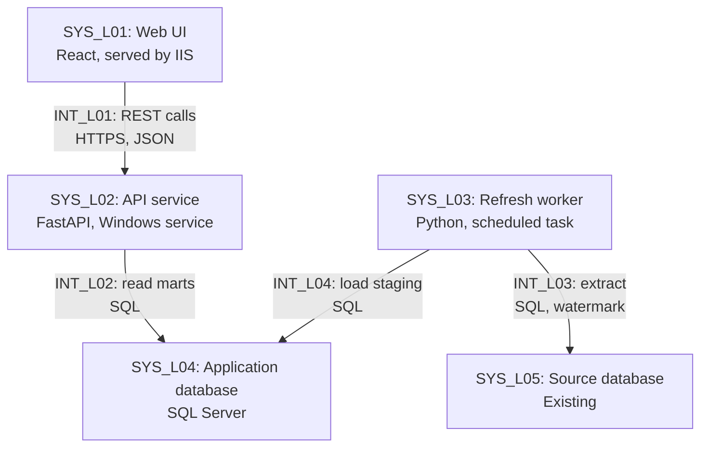
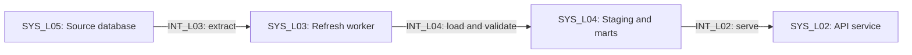
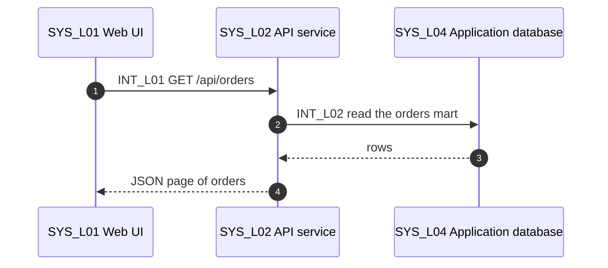

# /lld: the living Low-Level Design

The LLD is the engineering document that the team keeps current while the app changes. It holds the components, the
process flow, the end-to-end sequence, the interface contracts, the ETL and refresh schedules, and two sections that a
script generates: the database catalog (`db-catalog`) and the data lineage matrix (`data-lineage`). It replaces the
legacy `lld` pool skill and the `data-lineage` skill.

- The Markdown file in Git is the source of truth: `docs/<app>/<app>-lld.md`. Confluence is a copy.
- One engine publishes it: `caddis_confluence.py`. It turns each Mermaid block into a PNG attachment at 2x scale on a
  white canvas (headless Microsoft Edge, `msedge`), uploads a figure only when its SHA-256 changed, and writes each
  document into its own marked section of the page. Text outside the sections stays as it is.
- Never write Confluence storage XHTML by hand, never embed vector markup in the page, and never call another
  diagram converter.

## Input

- `$ARGUMENTS`: the app name and the Confluence page id. With no app, use the repo name. Ask for the page id only at
  the dry-run step.
- Keys, in the environment or in the caddis keys file: `CONFLUENCE_URL` (https only) and `CONFLUENCE_TOKEN`. Never
  print, echo or show the token.
- Renderer: Playwright for Python, Microsoft Edge and a local `mermaid.min.js` (`CADDIS_MERMAID_JS`). Prove the
  login and the renderer with `python "<home>/.caddis/bin/caddis_run.py" caddis_confluence.py check`.

## Steps

1. **Discover.** Read the hosts and service managers, ports, API routes and middleware, the database schemas, views
   and stored procedures, the ETL scripts and their schedules, the refresh loops and their watermarks, and which UI
   page calls which route. Read the HLA (`docs/<app>/<app>-hla.md`) when it exists, so that `SYS_Lxx` items map to its
   `SYS_xx` systems.
2. **Classification interview (mandatory gate).** Show one table of every internal component (`SYS_L01` ...) and
   every internal interface (`INT_L01` ...) with a proposed `Impacted` value, and a style class for each component. Ask the
   person to confirm or correct it in one turn. In a headless run (`CADDIS_HEADLESS` set), draw the figures with the
   proposed classes, write the document with `Status: Draft (classification not confirmed)` and stop before step 5.
3. **Write** `docs/<app>/<app>-lld.md` from the template below. Do not invent a route, a table or a schedule that the
   code does not show; write it as an open question instead.
4. **Preview the figures.** Run
   `python "<home>/.caddis/bin/caddis_run.py" caddis_confluence.py render-diagrams --input docs/<app>/<app>-lld.md --slug lld --out-dir <scratch folder>`.
   Fix the Mermaid source of every `FAIL` line.
5. **Dry run.** Run
   `python "<home>/.caddis/bin/caddis_run.py" caddis_confluence.py publish --page-id <ID> --slug lld --input docs/<app>/<app>-lld.md --dry-run`.
   Show the `ACTION:`, `PAGE:` and `FIGURES:` lines.
6. **Publish.** Run the same command without `--dry-run`. Report the `ACTION:`, `PAGE:` and `UPLOADED:` lines.
7. **Data lineage section.** Write `docs/<app>/<app>-data-lineage.md` (the matrix below, one row per UI dataset).
   Run the publish below with `--dry-run` first, then without it, to the same page:
   `python "<home>/.caddis/bin/caddis_run.py" caddis_confluence.py publish --page-id <ID> --slug data-lineage --input docs/<app>/<app>-data-lineage.md`.
8. **Database catalog section.** Wire the post-deploy hook below once. After that, every production deploy keeps the
   `db-catalog` section current, and no person edits it.

Stop at the first step that does not exit 0, and report its output.

## Generated sections

The LLD page holds three marked sections. Each has its own markers and its own anti-overwrite check:

| Slug | Source | Who writes it |
|---|---|---|
| `lld` | `docs/<app>/<app>-lld.md` | `/lld` (a person reviews it) |
| `data-lineage` | `docs/<app>/<app>-data-lineage.md` | `/lld` step 7, generated from the code |
| `db-catalog` | the app's catalog generator output | the post-deploy hook, never a person |

The data lineage matrix follows one dataset from end to end: domain -> source -> staging -> SP -> mart -> API -> UI.

| Domain | Source | Staging | Stored procedure | Mart | API route | UI page |
|---|---|---|---|---|---|---|
| <Domain> | <Source table or feed> | <Staging table> | <Procedure> | <Mart table or view> | <Route> | <Page> |

### Post-deploy hook: hash-gated `db-catalog` publish

Run it in the app pipeline after `deploy_prod` succeeds and the health check passes. Run the app's own catalog
generator first (for example its `generate_db_catalog.py`; its flags belong to the app), then:

```bash
CADDIS_HEADLESS=1 python "<home>/.caddis/bin/caddis_run.py" caddis_confluence.py publish-catalog --page-id <ID> --slug db-catalog \
  --input build/db-catalog/summary.md \
  --attach build/db-catalog/db-catalog.json --attach build/db-catalog/db-catalog.csv \
  --state-hash-file .caddis/state/db-catalog.sha256
```

- One SHA-256 covers the summary and every `--attach` file. The section shows that hash, and a link and a hash for
  each file.
- When `--state-hash-file` holds the same hash, the run ends before any request: `ACTION: unchanged`. A CI runner
  without a kept state file still makes no write: the live section and each attachment comment
  (`caddis sha256:<hex>`) are compared first.
- When the hash changed, only the changed files are uploaded and only the `db-catalog` section is rewritten
  (`ACTION: add` or `update`). When only an attachment is missing on the page, only that file is uploaded
  (`ACTION: attachments`).
- Exit 1 means a person edited the `db-catalog` section in Confluence (the diff is printed). Do not fail the release
  on it: run the step with continue-on-error and report it. A person removes the edit, then the next deploy publishes.
- The summary must not hold a Mermaid block (exit 4). Attachment names use letters, digits, `.`, `-` and `_`.

## Exit codes

| Exit | Meaning | What to do |
|---|---|---|
| 0 | Published, or unchanged | Nothing |
| 1 | Refused: a person edited the section in Confluence (a unified diff follows), a figure failed its check, or Confluence refused | Diff: copy the person's change into the Markdown; then a person publishes with `--force-overwrite` (the live hash still differs from the marker). Figure: fix the Mermaid source |
| 3 | Not configured, the renderer is missing, or the network failed | Add the keys, install the renderer, or try again later |
| 4 | Bad input: the slug, the page id, a file or an attachment name | Fix the command |

A person (never an agent, and never with `CADDIS_HEADLESS` set) may pass `--force-overwrite` after reading the diff.

## Diagram rules

- Mermaid only. Use `flowchart LR` for a process flow, `flowchart TB` for a topology and `sequenceDiagram` with
  `autonumber` for the end-to-end sequence. Keep a figure to about 12 nodes.
- Node ids are `SYS_L01`, `SYS_L02` ... and edge labels start with `INT_L01`, `INT_L02` ... Wrap label lines at about
  40 characters with `<br/>`.
- Give every node one style class: `existingStyle`, `newStyle`, `changedStyle`, `externalStyle`, `dataStyle` or
  `retiredStyle` (see `/hla`). The engine adds the class definition when the figure does not define it.
- Draw a scheduler or a job as a system, not as a person.

## Writing rules

- ASD-STE100 Simplified Technical English: short sentences, one idea each, active voice, common words.
- No em-dash and no en-dash. Straight ASCII quotes only. No filler words and no tool or model attribution.
- No secret, token, password, connection string or personal data, in the text, a figure or a catalog file.

## Template

~~~markdown
# Low-Level Design (LLD): <Application name>

## Document information

| Field | Value |
|---|---|
| Status | Draft |
| Version | 0.1 |
| Owner | <name or team> |
| HLA | <link to the HLA page> |

## 1. Components and service topology



| ID | Component | Runtime | Host and process | Port | Impacted |
|---|---|---|---|---|---|
| SYS_L01 | Web UI | <Runtime> | <Host, process> | <Port> | Yes |
| SYS_L02 | API service | <Runtime> | <Host, process> | <Port> | Yes |

## 2. Operational process flow



1. **Extract:** <What runs, when, and what it reads.>
2. **Load and validate:** <Checks, and what happens to a bad row.>
3. **Serve:** <Which routes read which marts.>

## 3. End-to-end sequence



## 4. Interfaces and API contracts

| ID | From | To | Method and route | Contract | Auth | Errors |
|---|---|---|---|---|---|---|
| INT_L01 | SYS_L01 | SYS_L02 | GET /api/orders | OpenAPI: <path to openapi.json> | <Auth> | <Codes> |

## 5. ETL, refresh schedules and watermarks

| Job | Schedule | Source | Target | Watermark | Idempotency | Volume |
|---|---|---|---|---|---|---|
| <Job> | <Cron or trigger> | <Source> | <Target> | <Column and rule> | <Rule> | <Rows per run> |

## 6. Stored procedures

| Procedure | Parameters | Reads | Writes | Called by |
|---|---|---|---|---|
| <Procedure> | <Parameters> | <Tables> | <Tables> | <Job or route> |

## 7. Reliability and recovery

| Failure | Detection | Automatic action | Person action |
|---|---|---|---|
| <Failure> | <Alert or check> | <Retry rule> | <Runbook step> |

## 8. Open questions

| ID | Question | Owner | Status |
|---|---|---|---|
| Q1 | <A route, table or schedule the code does not show> | <Owner> | Open |

## 9. Generated sections

The database catalog (`db-catalog`) and the data lineage matrix (`data-lineage`) are separate marked sections on this
page. Scripts write them. Do not copy them into this file.
~~~

## Rules

- Do not edit inside a marked section (`caddis-doc-<slug>-start-<hash8>` to `caddis-doc-<slug>-end`) in Confluence:
  the next publish refuses with a diff. Write comments and other text outside the markers.
- `/hla` owns the board view: context, NFRs, security and rollback. Link to it; do not copy it.
