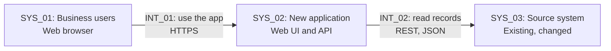
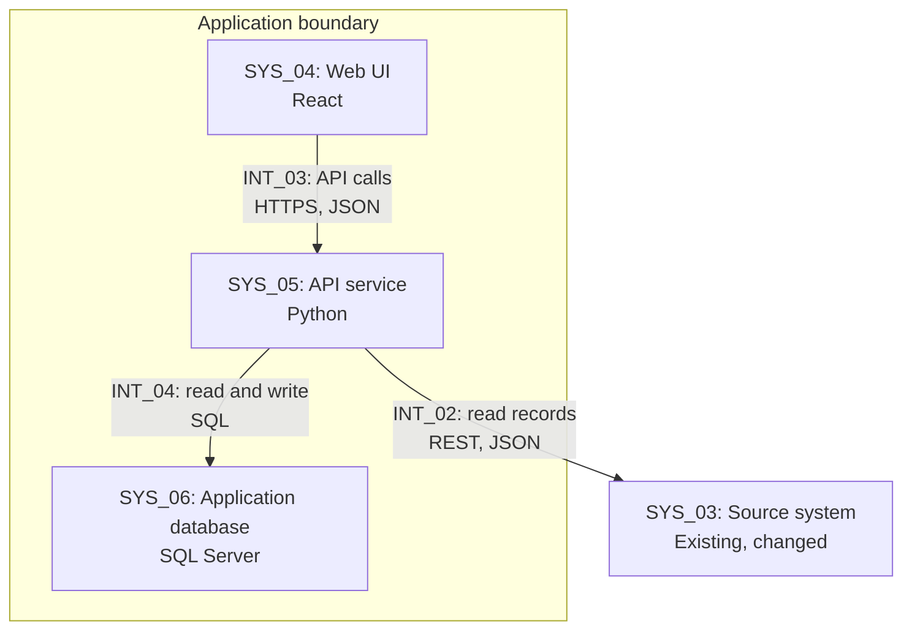

# /hla: High-Level Architecture for Gate 2 sign-off

The HLA is the document that the solution architecture board signs at Gate 2. It shows the systems, the interfaces
between them, what the change adds or changes, the non-functional targets, the security boundaries and the deploy and
rollback plan. It replaces the legacy `confluence-hla` and `hld` skills.

- The Markdown file in Git is the source of truth: `docs/<app>/<app>-hla.md`. Confluence is a copy.
- One engine publishes it: `caddis_confluence.py`. It turns each Mermaid block into a PNG attachment at 2x scale on a
  white canvas (headless Microsoft Edge, `msedge`), uploads a figure only when its SHA-256 changed, and writes the
  document into one marked section of the page. Text outside the section stays as it is.
- Never write Confluence storage XHTML by hand, never embed vector markup in the page, and never call another
  diagram converter.

## Input

- `$ARGUMENTS`: the app name and the Confluence page id. With no app, use the repo name. Ask for the page id only at
  the dry-run step.
- Keys, in the environment or in the caddis keys file: `CONFLUENCE_URL` (https only) and `CONFLUENCE_TOKEN`. Never
  print, echo or show the token.
- Renderer: Playwright for Python, Microsoft Edge and a local `mermaid.min.js` (`CADDIS_MERMAID_JS`). Prove the
  login and the renderer with `python "<home>/.caddis/bin/caddis_run.py" caddis_confluence.py check`.

## Steps

1. **Discover.** Read the code, the config, the deploy scripts, the database objects the app uses and the docs that
   exist. At HLA level, name systems, data domains and summary tables only. Leave routes, stored procedures and ETL
   detail to `/lld`. Do not invent a system, an interface or a target state that no code, note or person names.
2. **Classification interview (mandatory gate).** Show one table of every system (`SYS_01`, `SYS_02` ...) and every
   interface (`INT_01`, `INT_02` ...) with a proposed `Impacted` value (Yes or No), and a style class for each system. Ask
   the person to confirm or correct it in one turn. Do not draw a figure before they answer. In a headless run
   (`CADDIS_HEADLESS` set), draw the figures with the proposed classes, write the document with
   `Status: Draft (classification not confirmed)`, list each proposal under section 7 as an open question, and stop
   before step 5.
3. **Write** `docs/<app>/<app>-hla.md` from the template below. Keep every section. Write "None" or "Not in scope"
   in a section that does not apply, so the reader sees that it was considered.
4. **Preview the figures.** Run
   `python "<home>/.caddis/bin/caddis_run.py" caddis_confluence.py render-diagrams --input docs/<app>/<app>-hla.md --slug hla --out-dir <scratch folder>`.
   Each figure prints one `FIG` line. Fix the Mermaid source of every `FAIL` line and run it again.
5. **Dry run.** Run
   `python "<home>/.caddis/bin/caddis_run.py" caddis_confluence.py publish --page-id <ID> --slug hla --input docs/<app>/<app>-hla.md --dry-run`.
   Show the `ACTION:`, `PAGE:` and `FIGURES:` lines. A dry run writes nothing.
6. **Publish.** Run the same command without `--dry-run`. Report the `ACTION:`, `PAGE:` and `UPLOADED:` lines.
   A second run with no change prints `ACTION: unchanged` and makes no new page version.

Stop at the first step that does not exit 0, and report its output.

## Exit codes

| Exit | Meaning | What to do |
|---|---|---|
| 0 | Published, or unchanged | Nothing |
| 1 | Refused: a person edited the section in Confluence (a unified diff follows), a figure failed its check, or Confluence refused | Diff: copy the person's change into the Markdown; then a person publishes with `--force-overwrite` (the live hash still differs from the marker). Figure: fix the Mermaid source |
| 3 | Not configured, the renderer is missing, or the network failed | Add the keys, install the renderer, or try again later |
| 4 | Bad input: the slug, the page id or the file | Fix the command |

A person (never an agent, and never with `CADDIS_HEADLESS` set) may pass `--force-overwrite` after reading the diff.

## Diagram rules

- Mermaid only. Use `flowchart TB` for a tiered topology and `flowchart LR` for a flow. Keep a figure to about 12
  nodes; split a larger one into a context figure and a container figure.
- Node ids are `SYS_01`, `SYS_02` ... Each label starts with its id: `SYS_03["SYS_03: Orders API Python, FastAPI"]`.
- Edge labels start with the interface id: `-->|"INT_02: read orders HTTPS, JSON"|`.
- Wrap label lines at about 40 characters with ` `. A ` ` line break is the only markup allowed in a label.
- Give every node (system) one style class; edges take no class. The engine adds the class definition when the figure does not define it:

| Class | Use it for |
|---|---|
| `existingStyle` | An existing system that this change does not touch (`Impacted = No`) |
| `newStyle` | A new system (`Impacted = Yes`) |
| `changedStyle` | An existing system that this change modifies (`Impacted = Yes`) |
| `externalStyle` | A system outside the team's boundary: a vendor, a SaaS, another team |
| `dataStyle` | A database, a file store or a queue |
| `retiredStyle` | A system that this change retires |

- Draw a trust boundary as a `subgraph`. Draw a scheduler as a system, not as a person.
- The engine refuses a figure with overlapping nodes, a clipped label, a blank canvas or HTML-rendered labels (other markup than ` `). Fix the
  source; never edit the figure on the page.

## Writing rules

- ASD-STE100 Simplified Technical English: short sentences, one idea each, active voice, common words.
- No em-dash and no en-dash. Use a colon, brackets or a new sentence. Straight ASCII quotes only.
- No filler words ("seamless", "robust", "leverage", "delve") and no sentences about the document itself.
- No tool, agent or model attribution in the document.
- No secret, token, password, connection string or personal data, in the text or in a figure. Name a host or a
  database only when the reader needs it to sign the design.

## Template

~~~markdown
# High-Level Architecture (HLA): <Application name>

## Document information

| Field | Value |
|---|---|
| Status | Draft |
| Version | 0.1 |
| Owner | <name or team> |
| Gate | Gate 2: solution architecture sign-off |
| Jira Epic | <KEY> |

## 1. Executive summary

### 1.1 Goal

<One paragraph: the business problem and the outcome.>

### 1.2 Solution summary

<Three to five sentences: what the solution does, and which systems it adds or changes.>

### 1.3 Business value

- <Outcome 1, with a measure>
- <Outcome 2, with a measure>

## 2. Context and scope

### 2.1 In scope

- <Capability>

### 2.2 Out of scope

- <Capability>

### 2.3 Assumptions and constraints

- <Assumption>

## 3. Solution architecture

### 3.1 System context

### 3.2 Containers and boundaries

### 3.3 Systems

| ID | Name | Function | Technology | Hosting | Impacted |
|---|---|---|---|---|---|
| SYS_01 | Business users | Use the application | Web browser | Office network | No |
| SYS_02 | New application | <Function> | <Technology> | <Hosting> | Yes |
| SYS_03 | Source system | <Function> | <Technology> | <Hosting> | Yes |

### 3.4 Interfaces

| ID | From | To | Protocol | Data | Impacted |
|---|---|---|---|---|---|
| INT_01 | SYS_01 | SYS_02 | HTTPS | <Data> | Yes |
| INT_02 | SYS_02 | SYS_03 | REST, JSON | <Data> | Yes |

## 4. Non-functional requirements and SLAs

| NFR | Target | How we measure it |
|---|---|---|
| Availability | <99.5% in business hours> | <Health check and uptime report> |
| Response time | <p95 under 2 s per page> | <API timing log> |
| Data freshness | <Under 15 min> | <Watermark age> |
| Recovery | <RPO and RTO> | <Restore test> |

## 5. Security, authentication and data protection

- **Authentication:** <How a user and a service prove who they are.>
- **Authorization:** <Roles, and who grants them.>
- **Network boundary:** <What is exposed, and to whom.>
- **Data protection and redaction:** <Data classes, encryption in transit and at rest, what is masked or never stored.>
- **Audit:** <What is logged, and for how long.>

## 6. Deployment and rollback

- **Environments:** <DEV, UAT, PROD.>
- **Deploy path:** <CI pipeline, approvals, release window.>
- **Rollback:** <The steps to return to the last good release, and the data rollback.>

## 7. Risks, decisions and open questions

| ID | Type | Description | Owner | Status |
|---|---|---|---|---|
| R1 | Risk | <Description> | <Owner> | Open |

## 8. Glossary

| Term | Meaning |
|---|---|
| <Term> | <Meaning> |
~~~

## Rules

- The section on the page is bounded by two anchor markers (`caddis-doc-hla-start-<hash8>` and `caddis-doc-hla-end`).
  Do not edit inside them in Confluence: the next publish refuses with a diff. Write comments and other text outside
  the markers.
- Publish the HLA and the LLD to different pages, or to one page with the slugs `hla` and `lld`.
- `/lld` owns the detail: routes, stored procedures, ETL schedules, the database catalog and the data lineage matrix.
